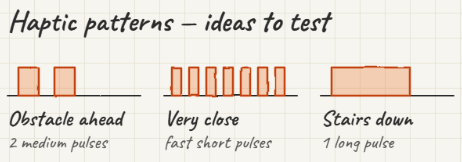

# FeelPath

A cane that tells you, through vibration, what is in front of you.

**Stage 1 (this repo):** a prototype that uses only an iPhone with a LiDAR scanner (iPhone 12 Pro and later; developed on an iPhone 17 Pro Max). You strap the phone to a cane, or hold it pointing ahead. The phone reads the LiDAR depth map and plays one of three vibration patterns.



| Situation | Pattern | Default trigger |
|---|---|---|
| **Obstacle ahead** | 2 medium pulses, repeated every second | something in your path within 2.0 m |
| **Very close** | fast short pulses, continuous | something within 0.8 m |
| **Stairs down** | 1 long pulse, repeated every 1.6 s | the floor ahead drops ≥ 14 cm |

Priority: very close > stairs down > obstacle ahead. You can change the distances in the app, and test each pattern on its own with the "Feel the patterns" buttons.

## How it works

```
ARKit LiDAR depth (256×192, ~15 Hz)
   │  every 4th pixel, medium+ confidence
   ▼
DepthSensor ── unprojects each pixel with the camera pose → points as
   │           (forward, lateral, height) relative to the phone, gravity-aligned
   ▼
SceneAnalyzer (FeelPathCore)
   │  • floor height = robust median of points 0.3–1.2 m ahead
   │  • obstacle    = 10th-percentile forward distance of points in a 70 cm-wide
   │                  corridor that stand ≥ 12 cm above the floor
   │  • floor drop  = ≥ 30 % of ground points 0.8–2.5 m ahead are ≥ 14 cm below the floor
   ▼
AlertDecider (FeelPathCore) ── hysteresis + 3-frame confirmation for stairs
   ▼
HapticRenderer ── Core Haptics, loops the pattern for the current alert
```

Because the points are projected into world space, the phone's tilt doesn't matter, which is what makes stairs detection possible. Inspired by [OpenCane](https://github.com/aritroBh/OpenCane/), which uses the same ARKit `sceneDepth` + Core Haptics approach.

## Repo layout

```
ios/
  project.yml            XcodeGen spec (the .xcodeproj is generated, not committed)
  Core/                  FeelPathCore: pure Swift logic + unit tests (no iOS frameworks)
  FeelPath/
    App/                 FeelPathApp, AppModel (glue)
    Depth/DepthSensor    ARKit session → points → SceneReading
    Haptics/             Core Haptics renderer
    UI/ContentView       status, start/stop, settings, pattern tester, debug
docs/
```

## Running it on your iPhone

To build and install an iOS app you need **a Mac with Xcode 16 or later**. Windows can edit the code but can't build it. A free Apple ID works for installing on your own phone; the app then has to be re-installed every 7 days.

```bash
brew install xcodegen
cd ios
xcodegen
open FeelPath.xcodeproj
```

Then in Xcode:
1. Select the **FeelPath** target → *Signing & Capabilities* → choose your team (your Apple ID). If the bundle id `com.feelpath.app` is taken, change it to something unique.
2. Plug in the iPhone, enable **Developer Mode** on it (Settings → Privacy & Security), and select it as the run destination.
3. Press ▶︎. Allow camera access on first launch.

The simulator can build the app but has no LiDAR or Taptic Engine, so all real testing is on the device.

## Tests

The logic is in `ios/Core` and runs on macOS, Linux, or Docker:

```bash
cd ios/Core && swift test
```

On Windows with Docker Desktop running:

```bash
docker run --rm -v "$PWD/ios/Core:/src" -w /src swift:6.1 swift test
```

CI (GitHub Actions) runs these tests on Linux and builds the iOS app for the simulator on every push.

## Field-testing checklist

- [ ] Wall at 3 m → 2 m → 0.5 m: the cue goes clear → obstacle → very close
- [ ] Narrow pole (lamp post), chair, table edge at hip height
- [ ] Top of a staircase, kerb, single step down
- [ ] Phone angles: pointing level, 30° down, 60° down
- [ ] Bright sun outdoors (LiDAR range drops), darkness indoors
- [ ] Glass doors and mirrors (LiDAR may see through them: a known limitation)

## Next steps

- Tune the thresholds from field tests (all of them are in `AnalyzerConfig` / `DeciderConfig`)
- Stairs **up** / overhanging obstacles at head height (separate cue)
- Left/right hints (which side is clear)
- Stage 2: dedicated hardware (ToF sensor + vibration motor in the cane grip)
